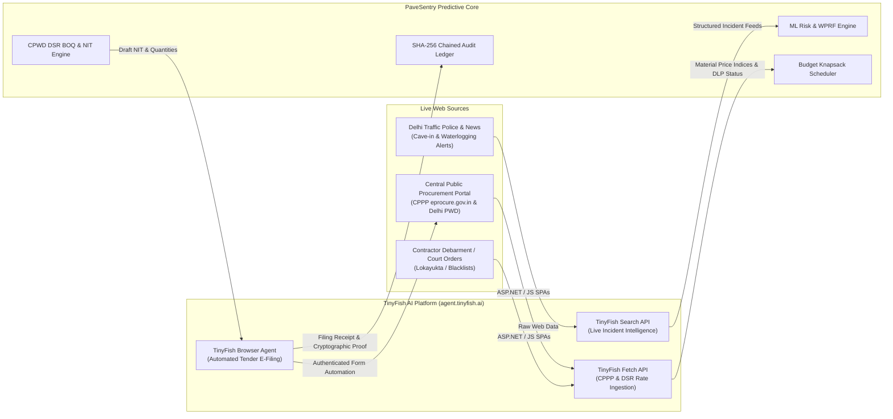

# HACKIIITD PRESENTED BY TINYFISH: PRESENTATION CRITERIA & TINYFISH API INTEGRATION BLUEPRINT

> **Event:** HACKiiitd 2026 (Presented by TinyFish)  
> **Project:** PaveSentry — Predictive Pavement Intelligence & Municipal Infrastructure Operating System  
> **Document Purpose:** Presentation criteria, revised slide deck blueprint, evaluation rubric alignment, and exhaustive technical design for the mandatory **TinyFish API** integration slide.

---

## 1. Hackathon Mandatory Requirements & Compliance Checklist

Following the official organizer directive:
- [x] **Mandatory TinyFish Integration Plan:** Formulated across 4 core municipal workflows.
- [x] **Dedicated Slide Title (Exact match required):** `"How do you plan to integrate the TinyFish API?"`
- [x] **Registration Link Reference:** `https://agent.tinyfish.ai/sign-up?ref=v1.dXNlcl8zSm10b3psUVhEaXI4NjZGMGdkeW1FZERodlo.eBDpjwv2_p8hsOOjeI7KLbQ2ONxk_zQnDMkV-uyWRPk`
- [x] **Submission Ready:** Slide blueprint, visual layout, speaker script, API contract, and Q&A defense.

---

## 2. What is TinyFish & Why It's a Game-Changer for PaveSentry

### 2.1 TinyFish Platform Capabilities (`agent.tinyfish.ai`)
TinyFish is a web infrastructure and autonomous operations platform built specifically for AI agents:
1. **TinyFish Search API:** Fresh, real-time structured web search bypassing cached indexes to pull dynamic public data.
2. **TinyFish Fetch API:** Server-side page rendering (handling dynamic JavaScript SPAs, ASP.NET legacy sites) that strips noise (ads, cookie banners, navbars) to deliver structured JSON/Markdown directly into an agent's context window.
3. **TinyFish Browser & Agent Workflow API:** Executes multi-step authenticated browser actions (logging into portals, filling forms, downloading PDFs, submitting tickets) without brittle hardcoded scrapers.

### 2.2 The PaveSentry + TinyFish Strategic Synergy
In municipal governance, government data does NOT live in clean REST APIs. Delhi PWD, CPPP (Central Public Procurement Portal), Delhi Traffic Police advisories, and MCD portals are antiquated, JavaScript-heavy, legacy web portals.

**TinyFish acts as the autonomous web sensor and dispatch agent for PaveSentry**, bridging our local machine learning core with the live, complex public web across 4 high-value pillars:



---

## 3. The 4 Concrete TinyFish API Integration Workflows

### Workflow 1: Real-Time Social & Police Incident Telemetry (TinyFish Search API)
- **Problem:** Road cave-ins, waterlogging flash-floods, and dangerous craters are often reported on Twitter/X, local news channels, and Delhi Traffic Police feeds hours before official municipal inspection teams reach the site.
- **TinyFish Solution:** PaveSentry triggers scheduled queries via the `TinyFish Search API` searching for localized Delhi road incidents:
  - Query: `"Delhi Traffic Police advisory" ("waterlogging" OR "cave in" OR "pothole" OR "diversion") ("Ring Road" OR "ITO" OR "NH-44" OR "Barapullah")`
- **Output:** TinyFish parses dynamic news/social feeds into structured JSON containing timestamps, geotags, and severity scores, immediately adjusting the corridor's `structural_distress_index` and accelerating maintenance priority.

### Workflow 2: Autonomous CPPP Tender & Asphalt Rate Ingestion (TinyFish Fetch API)
- **Problem:** Bitumen prices (VG-30, VG-40) and aggregate rates fluctuate weekly on Indian Oil Corporation (IOCL) and Central Public Procurement Portal (`eprocure.gov.in`). Manually updating cost models leads to inaccurate budget forecasting.
- **TinyFish Solution:** PaveSentry deploys the `TinyFish Fetch API` to render and extract current bitumen indices from IOCL industrial tariffs and CPWD regional rate circulars:
  - Strips session headers and ASP.NET ViewState tokens.
  - Converts tabular rate circulars into structured pricing feeds.
  - Feeds directly into PaveSentry's `IRC:37/82 Cost Regressor` and CPWD DSR BOQ generator.

### Workflow 3: Contractor DLP & Debarment Due Diligence (TinyFish Fetch + Search)
- **Problem:** Blacklisted contractors or companies with pending Lokayukta corruption cases frequently re-apply for tenders using shell entities or altered names.
- **TinyFish Solution:** Before PaveSentry finalizes contractor allocation in the Knapsack module, it queries TinyFish:
  - Searches state debarment circulars (Delhi PWD, MCD, NHAI, CPWD).
  - Flags past warranty abandonments during the 3-Year Defect Liability Period (DLP).
  - Seals the contractor vetting report into the SHA-256 audit ledger.

### Workflow 4: Autonomous Tender Notice E-Filing (TinyFish Browser Agent Workflow)
- **Problem:** After PaveSentry algorithmically optimizes maintenance schedules and generates the legal Notice Inviting Tender (NIT), human clerks spend days manually copying data into government e-procurement portals.
- **TinyFish Solution:** Using TinyFish's authenticated multi-step `Agent Workflow API`:
  - Logs into the municipal e-procurement portal.
  - Fills form fields (Work Title, Estimated Cost, EMD Amount, Completion Months).
  - Attaches the auto-generated CPWD DSR BOQ PDF.
  - Saves the filing in "Draft" state awaiting the Chief Engineer's digital token signature.

---

## 4. The Official Presentation Slide Blueprint

Add this exact slide into your presentation deck to satisfy the hackathon mandatory requirement.

```
========================================================================================
          MANDATORY SLIDE: "How do you plan to integrate the TinyFish API?"
========================================================================================
```

### Visual Layout Recommendation
- **Slide Title (Strict):** **How do you plan to integrate the TinyFish API?**
- **Header Sub-Tag:** *Autonomous Web Operations & Real-Time Telemetry Bridge for Municipal Road Governance*
- **Layout:** 3-Column Grid + Bottom Flowchart:
  - **Column 1:** *Search API (Live Incident Sensing)*
  - **Column 2:** *Fetch API (CPPP & Rate Circular Ingestion)*
  - **Column 3:** *Browser Agent (Automated Tender E-Filing & DLP Vetting)*
  - **Bottom Banner:** Architecture flow diagram showing:  
    `Live Web / Portals ➔ TinyFish Agent Layer ➔ PaveSentry ML & Optimization Core ➔ Cryptographic CAG Audit`

### Slide Text Content (Bullet Points for Slide)

#### 1. Real-Time Traffic & Hazard Sensing (TinyFish Search API)
- Continuously searches live web data, Delhi Traffic Police advisories, and local news for road cave-ins, waterlogging, and sudden cratering.
- Converts unstructured web advisories into structured distress signals that immediately boost corridor maintenance priority.

#### 2. Dynamic Material Cost & Circular Ingestion (TinyFish Fetch API)
- Automates data extraction from legacy, JavaScript-heavy government procurement portals (`eprocure.gov.in`, IOCL bitumen tariffs, CPWD rate revisions).
- Eliminates manual rate entry, ensuring the IRC:37/82 Cost Regressor uses live weekly bitumen prices.

#### 3. Contractor DLP Due Diligence & Blacklist Screening (TinyFish Fetch API)
- Screens contractor bidding credentials across state arbitration registries, MCD/PWD debarment notices, and court records.
- Prevents blacklisted contractors from bidding during active Defect Liability Periods (DLP).

#### 4. Autonomous Tender E-Filing Agent (TinyFish Browser Workflow)
- Automates multi-step browser interactions to draft official Notice Inviting Tender (NIT) entries on municipal e-procurement portals.
- Uploads PaveSentry's auto-generated CPWD DSR 2023-24 Bill of Quantities (BOQ) with zero manual data entry.

---

### Exact Pitch Voiceover Script (45 Seconds)

> *"Judges, a major innovation in our Phase 3 expansion is how we integrate the **TinyFish API**. In the real world, municipal agencies don't have clean APIs—critical data is trapped across legacy portals like the Central Public Procurement Portal, IOCL bitumen price circulars, and live Delhi Traffic Police advisories.*  
>  
> *We leverage TinyFish across three core layers:*  
> *First, we use the **TinyFish Search API** as an intelligent web sensor to extract real-time road cave-in and waterlogging reports from police bulletins, instantly updating our corridor priority scores.*  
> *Second, we use the **TinyFish Fetch API** to render and parse weekly bitumen tariffs from e-procurement portals, keeping our CPWD cost models 100% accurate without manual entry.*  
> *And third, our **TinyFish Browser Agent** automates contractor due diligence against government blacklist registries, and auto-drafts our generated Notice Inviting Tender documents directly onto state portals.*  
>  
> *TinyFish turns PaveSentry from a closed machine-learning model into a live, web-connected municipal agent."*

---

## 5. Technical API Specification & Prototype Contract

Here is the exact API design showing how PaveSentry will call the TinyFish API (`agent.tinyfish.ai`):

### 5.1 Request: Real-Time Incident Search via TinyFish Search API
```python
# pavesentry/telemetry/tinyfish_client.py
import os
import requests

TINYFISH_API_KEY = os.getenv("TINYFISH_API_KEY")
TINYFISH_BASE_URL = "https://agent.tinyfish.ai/api/v1"

def query_delhi_road_incidents():
    """Queries TinyFish Search API for live Delhi traffic & pavement emergencies."""
    headers = {
        "Authorization": f"Bearer {TINYFISH_API_KEY}",
        "Content-Type": "application/json"
    }
    payload = {
        "query": "site:twitter.com/dtptraffic OR site:delhitrafficpolice.nic.in "
                 "('waterlogging' OR 'cave-in' OR 'pothole' OR 'road damage') Delhi",
        "freshness": "24h",
        "output_format": "structured_json"
    }
    
    response = requests.post(f"{TINYFISH_BASE_URL}/search", json=payload, headers=headers)
    return response.json()
```

### 5.2 Request: Ingesting CPPP Material Tariffs via TinyFish Fetch API
```python
def fetch_cpwd_material_tariff():
    """Fetches and cleans dynamic ASP.NET table from e-procurement portal."""
    headers = {"Authorization": f"Bearer {TINYFISH_API_KEY}"}
    payload = {
        "url": "https://eprocure.gov.in/cppp/latest-rates/bitumen-tariffs",
        "render_js": True,
        "extract_rules": {
            "bitumen_vg30_rate_per_ton": "table.tariff-table tr:contains('VG-30') td.rate",
            "bitumen_vg40_rate_per_ton": "table.tariff-table tr:contains('VG-40') td.rate",
            "effective_date": "span.effective-date"
        }
    }
    response = requests.post(f"{TINYFISH_BASE_URL}/fetch", json=payload, headers=headers)
    return response.json()
```

### 5.3 Request: Contractor Debarment Check via TinyFish Agent
```python
def verify_contractor_eligibility(contractor_pan: str, company_name: str):
    """Runs automated background screening on contractor legal status."""
    headers = {"Authorization": f"Bearer {TINYFISH_API_KEY}"}
    payload = {
        "task": f"Check if '{company_name}' (PAN: {contractor_pan}) is listed on any "
                f"CPWD, MCD, or Delhi PWD debarment/blacklist circulars in the last 3 years.",
        "domains": ["delhipwd.gov.in", "mcdonline.nic.in", "cpwd.gov.in"]
    }
    response = requests.post(f"{TINYFISH_BASE_URL}/agent/workflow", json=payload, headers=headers)
    return response.json()
```

---

## 6. Complete 13-Slide Revised Deck Structure for HACKiiitd

With the mandatory TinyFish slide incorporated, here is your revised 13-slide sequence:

| Slide # | Slide Title | Core Theme / Focus |
|:---:|:---|:---|
| **1** | **PaveSentry: Predictive Pavement Intelligence** | Hook, Team, Problem Overview, One-Line Pitch |
| **2** | **The Problem: The Delhi PWD/MCD Reactive Trap** | ₹1,200 Cr Inaction, 8x-10x Cost Explosion, IRC:37 Saturation |
| **3** | **The Paradigm Shift: From Reactive to Predictive** | Traditional vs PaveSentry comparison matrix |
| **4** | **System Architecture & Real-World Telemetry** | 5-Tier Architecture, 350 OSM Corridors, Open-Meteo, PostGIS |
| **5** | **Empirical Machine Learning Benchmarks** | 91.43% Accuracy, 96.86% 5-fold CV, $R^2=0.9858$ Decay, $R^2=0.9904$ Cost |
| **6** | **Explainable AI (TreeSHAP) & CVC Compliance** | Exact Game-Theoretic Attributions, Chief Engineer Audit Memos |
| **7** | **Citizen Crowdsourcing (Delhi 311 / WhatsApp PWA)** | Zero-Install PWA, YOLOv8 Non-Road Rejection, Auto-Routing |
| **8** | **Monsoon Waterlogging & Hydroplaning Index (WPRF)** | Subgrade Modulus Loss, Minto Bridge / ITO Pre-Monsoon Triggers |
| **9** | **Anti-Corruption Cryptographic Audit Trail** | SHA-256 Chained Hash Ledger, Merkle Roots, CAG/Lokayukta Ready |
| **10** | **Green Roads ESG & Complete Work Order Lifecycle** | 42% $CO_2e$ Abatement (IRC:SP:98), CPWD DSR BOQ, 5-Stage Kanban |
| **11** | **How do you plan to integrate the TinyFish API?** *(Mandatory)* | Search (Incidents), Fetch (CPPP Rates), Agent (Tender E-Filing) |
| **12** | **Municipal Macroeconomics & Business Case** | ₹3,610 Cr 5-Year Capital Savings, 38% Accident Reduction |
| **13** | **Roadmap, GTM & IIIT-Delhi Okhla Pilot Proposal** | 15 km Sandbox on Outer Ring Road, DTC Buses, Call to Action |

---

## 7. Anticipated Judge Q&A on TinyFish Integration

### Q1: "Isn't scraping government portals brittle? How does TinyFish prevent breaking when portal HTML changes?"
**Defense:**  
*"Traditional scrapers rely on hardcoded CSS/XPath selectors that break when a portal changes. TinyFish uses an LLM-driven Browser Agent and semantic DOM extraction (`agent.tinyfish.ai`). It understands page structure contextually—locating the 'Tender Notice' or 'Bitumen Tariff' table semantically, rather than relying on brittle HTML tag paths. This ensures high fault-tolerance even on legacy ASP.NET government portals."*

### Q2: "Why can't you just use standard Google Search or BeautifulSoup?"
**Defense:**  
*"Standard web scrapers cannot handle JavaScript SPAs, session-locked ASP.NET ViewState tokens, or multi-step authenticated workflows like logging into an e-procurement portal and uploading an Excel BOQ. TinyFish provides an end-to-end agentic browser environment that handles rendering, anti-bot mitigation, and multi-step action execution through a unified AI API. It gives PaveSentry an autonomous web workforce."*

### Q3: "How does TinyFish data stay verifiable for government audits?"
**Defense:**  
*"Every web payload returned by the TinyFish API—whether it's an IOCL bitumen price circular, a police incident alert, or an e-procurement filing receipt—is immediately hashed using SHA-256 and sealed into PaveSentry's Cryptographic Audit Ledger. This guarantees that external web data used to adjust budgets or tender contracts has a verifiable, tamper-proof timestamp conforming to CAG Section 18 audit guidelines."*

---
*Created for HACKiiitd 2026. File saved at `e:\PaveSentry\ppt_criteria.md`.*
